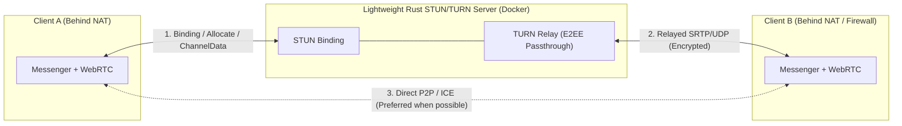
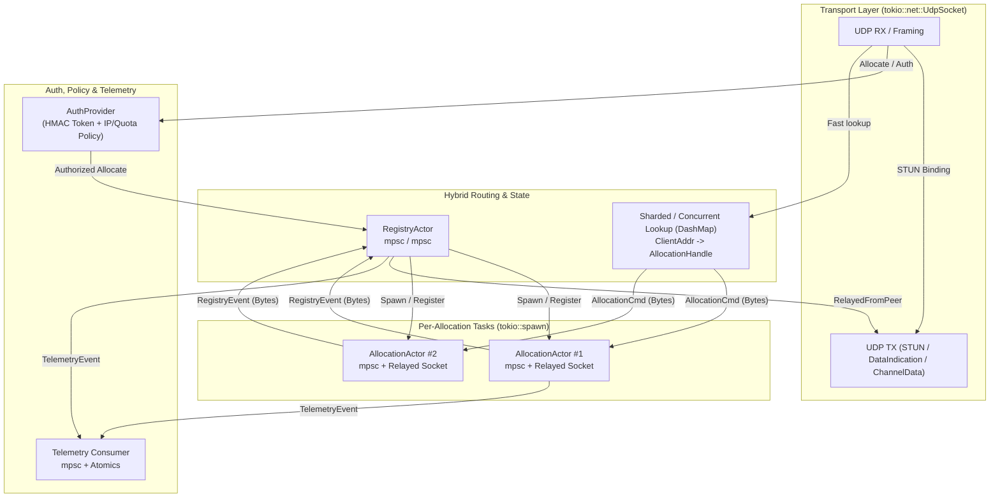

# Architecture Specification: Lightweight STUN/TURN Relay Server (Rust + Docker) for an E2EE Messenger (Wire-like)

**Status:** Draft v1.0  
**Language & Runtime:** Rust (`tokio` async runtime)  
**Deployment:** Docker (`Dockerfile` + `compose.yaml`)  
**Concurrency Model:** Hybrid — **message passing** for state, lifecycle, and control operations; **controlled shared-memory / zero-copy patterns** (`bytes::Bytes`, `Arc`, sharded/lock-free lookup maps, atomics) for the high-frequency media relay path.

---

## 1. Purpose and Scope

### 1.1. Application Context
In a messenger and voice/video calling system modeled after **Wire**, real-time media relies on **WebRTC / ICE** and **End-to-End Encryption (E2EE, e.g., SRTP/DTLS-SRTP)**:
* **STUN** enables clients to discover their reflexive (public) address (`XOR-MAPPED-ADDRESS`) and perform ICE connectivity checks.
* **TURN** acts as a fallback media relay when direct peer-to-peer (P2P) or STUN-assisted paths fail (symmetric NAT, strict firewalls, restrictive networks).
* **E2EE Guarantee:** The relay server forwards encrypted media packets between peers without accessing encryption keys or plaintext content.

### 1.2. "No `coturn` Bloat" Principle
Rather than porting every historical feature and legacy extension of `coturn` 1:1, this specification defines a **focused, secure, and fast relay server** tailored to modern ICE/WebRTC clients:

* **Included in MVP (Phases 1–2):**
  * STUN `Binding Request` / `Binding Success Response` (`XOR-MAPPED-ADDRESS`, optional `FINGERPRINT`).
  * TURN `Allocate`, `Refresh`, `CreatePermission`, `ChannelBind` (`0x4000..=0x7FFF`), `Send` / `Data` indication, and `ChannelData` over **UDP**.
  * Short-lived (time-limited / HMAC) credentials integrated with the messenger's auth/session layer.
  * Strict security policies: blocking relay to private/loopback/link-local IP ranges, plus per-user/global allocation and traffic quotas.
* **Deferred to Later Phases:**
  * ICE-TCP / TURN-over-TCP, TLS/DTLS listeners, external SQL/LDAP backends, and legacy/niche RFC extensions until the UDP core is proven under load.



---

## 2. Concurrency Model: Message Passing + Controlled Shared Memory

A TURN server combines two distinct workloads:
1. **Control & Lifecycle Plane (lower frequency, higher state complexity):** authentication, allocation creation and refresh, `LIFETIME` expiration, `permissions` and `channel_bindings` updates, quota checks, metrics, and `SIGTERM` shutdown.
2. **Data / Relay Plane (high packet rate, latency-sensitive):** forwarding every incoming UDP packet to the target peer or client with minimal overhead and copying.

### 2.1. Where Message Passing Is Used
* **Actor / Task per TURN Allocation (`AllocationActor`):** Each active allocation runs as an isolated `tokio` task owning a bounded `mpsc` command channel (`mpsc::Receiver<AllocationCmd>`). All state mutations on that allocation happen sequentially inside its task without mutexes around individual allocations.
* **Registry & Lifecycle Coordination (`RegistryActor`):** Allocation creation, registration, timer expirations, and cleanup flow through typed messages (`RegistryCmd` / `RegistryEvent`) with `oneshot` replies for synchronous outcomes.
* **Telemetry, Audit, and Quotas:** Events such as allocation open/close, quota breaches, or policy rejections are emitted asynchronously over a bounded channel to a telemetry/logging consumer so they never stall packet forwarding.

### 2.2. Where and Why Shared-Memory Patterns Are Used
Sending a separate message that copies payload buffers for *every* media packet across hundreds or thousands of concurrent audio/video streams introduces avoidable scheduling and allocation overhead. Instead, a hybrid approach is used:

1. **Reference-Counted Immutable Buffers (`bytes::Bytes`):**
   * Packet payloads are wrapped in `Bytes`. Cloning a `Bytes` handle increments an atomic reference count without copying the underlying payload bytes.
   * Allows payloads to move across tasks or be forwarded without reallocating media buffers.
2. **Sharded / Lock-Free Lookup Tables on the Data Plane (`DashMap` or Per-Worker Sharding):**
   * Looking up an `AllocationHandle` (`mpsc::Sender` is `Clone` and lightweight) by client address or `5-tuple` on the hot path can use a sharded/concurrent map (`DashMap`) or worker-local routing tables to avoid a single central bottleneck in `RegistryActor` at high PPS (packets per second).
3. **Atomic Counters (`AtomicU64` / `AtomicUsize`) for Global Metrics:**
   * Active allocation counts, total relayed bytes, and dropped packets can be read for metrics/health endpoints using `Ordering::Relaxed` without locks.
4. **Bounded Channels (`mpsc::channel(capacity)`) for Backpressure:**
   * All inter-task channels use explicit bounds (e.g., `256..2048` depending on role) with `try_send` / backpressure handling so a slow consumer or traffic burst cannot cause unbounded heap growth.



---

## 3. Component Architecture and Data Flows

### 3.1. Rust Project Layout

```text
stun-turn-relay/
├── Cargo.toml
└── src/
    ├── main.rs          # Startup, config loading, SIGTERM/SIGINT handling, task wiring
    ├── config.rs        # Env/CLI configuration and validation
    ├── error.rs         # Domain error types (TurnError, CodecError, ConfigError)
    ├── protocol/        # STUN/TURN binary codec, headers, and attributes
    │   ├── mod.rs
    │   ├── stun.rs
    │   └── turn.rs
    ├── auth/            # Credential validation, nonce checks, IP & quota policies
    │   ├── mod.rs
    │   └── hmac_auth.rs
    ├── transport/       # UDP socket reader/writer, framing, and relay path
    │   └── udp.rs
    ├── registry/        # RegistryActor, port pool, routing index, lifecycle events
    │   └── mod.rs
    ├── allocation/      # AllocationActor, permissions, channels, lifetime timer
    │   └── mod.rs
    └── telemetry/       # Metrics, structured logs, and session lifecycle events
        └── mod.rs
```

### 3.2. Module Responsibilities

* **`config`:** Parses and validates environment variables (`LISTEN_ADDR`, `EXTERNAL_IP`, `RELAY_MIN_PORT`, `RELAY_MAX_PORT`, `MAX_ALLOCATIONS`, `MAX_ALLOCATIONS_PER_USER`, `ALLOCATION_LIFETIME_SECS`, `AUTH_SECRET`, `CHANNEL_CAP`, `METRICS_ADDR`).
* **`protocol`:** Parses and serializes STUN/TURN headers (20-byte STUN header, 4-byte `ChannelData` header in `0x4000..=0x7FFF`) and attributes (`XOR-MAPPED-ADDRESS`, `XOR-RELAYED-ADDRESS`, `LIFETIME`, `CHANNEL-NUMBER`, `DATA`, `USERNAME`, `REALM`, `NONCE`, `MESSAGE-INTEGRITY`, `ERROR-CODE`). All parsers return `Result` and never `panic` on malformed network input.
* **`auth`:** Implements `AuthProvider` — validates short-lived credentials (e.g., `<timestamp>:<user_id>` signed with HMAC-SHA256 using `AUTH_SECRET`), enforces per-user and global allocation limits, and blocks disallowed peer IP ranges (loopback, RFC1918 private, link-local, unspecified, multicast).
* **`transport`:** Manages the primary listening `UdpSocket`, distinguishes `ChannelData` from STUN/TURN messages, dispatches control requests to `RegistryActor`, and forwards relayed payloads using `Bytes`.
* **`registry`:** Allocates relay UDP ports from `RELAY_MIN_PORT..=RELAY_MAX_PORT`, spawns `AllocationActor` tasks, maintains active allocation indexes, and processes `RegistryEvent` notifications.
* **`allocation`:** Owns a single allocation's state (`client_addr`, `relayed_socket`, `permissions`, `channel_bindings`, `expires_at`, `bytes_relayed`), processes `AllocationCmd` messages, tracks `lifetime` via `tokio::time::sleep_until` inside `tokio::select!`, and receives peer packets on `relayed_socket`.
* **`telemetry`:** Consumes `TelemetryEvent` messages over a bounded channel and updates atomic counters/logs without blocking packet relay.

### 3.3. Key Sequence Flows

```mermaid
sequenceDiagram
    autonumber
    participant C as Client (Messenger)
    participant T as Transport (UDP)
    participant A as AuthProvider
    participant R as RegistryActor
    participant Actor as AllocationActor
    participant Peer as Remote Peer

    C->>T: STUN Binding Request
    T-->>C: STUN Binding Response (XOR-MAPPED-ADDRESS)

    C->>T: TURN Allocate (with short-lived HMAC credentials)
    T->>A: Validate credentials & quotas
    A-->>T: Valid (username, max_lifetime)
    T->>R: RegistryCmd::Allocate { client_addr, username, ... }
    R->>R: Reserve relay port & bind UdpSocket
    R->>Actor: tokio::spawn(AllocationActor)
    R-->>T: Ok(AllocationInfo { id, relayed_addr, lifetime_secs })
    T-->>C: TURN Allocate Success (XOR-RELAYED-ADDRESS, LIFETIME)

    C->>T: TURN CreatePermission / ChannelBind
    T->>Actor: AllocationCmd::CreatePermission / ChannelBind (oneshot)
    Actor-->>T: Ok(())
    T-->>C: Success Response

    loop Media Relay (SRTP over UDP)
        C->>T: ChannelData / Send Indication
        T->>Actor: AllocationCmd::SendOnChannel / SendToPeer (Bytes)
        Actor->>Peer: relayed_socket.send_to(payload, peer_addr)
        Peer-->>Actor: relayed_socket.recv_from(buf)
        Actor->>R: RegistryEvent::RelayedFromPeer (Bytes)
        R->>T: Forward to client transport
        T-->>C: ChannelData / Data Indication
    end

    alt Lifetime expires or Shutdown
        Actor->>Actor: sleep_until(expires_at) elapses / Shutdown cmd
        Actor->>R: RegistryEvent::AllocationClosed { id, bytes_relayed }
        R->>R: Release port & remove from routing table
    end
```

### 3.4. Allocation Actor State Machine

```mermaid
stateDiagram-v2
    [*] --> Active: Allocate & Spawn Task
    Active --> Active: Refresh (reset expires_at)
    Active --> Active: CreatePermission / ChannelBind
    Active --> Active: SendToPeer / RelayedFromPeer
    Active --> Closing: Lifetime Expired
    Active --> Closing: AllocationCmd::Shutdown / SIGTERM
    Closing --> [*]: Drop Socket & Emit AllocationClosed
```

---

## 4. Message and Domain Types Specification (Rust)

```rust
use bytes::Bytes;
use std::net::{IpAddr, SocketAddr};
use tokio::sync::{mpsc, oneshot};

#[derive(Debug, Clone, Copy, PartialEq, Eq, Hash)]
pub struct AllocationId(pub u64);

#[derive(Debug, Clone)]
pub struct AllocationHandle {
    pub id: AllocationId,
    pub tx: mpsc::Sender<AllocationCmd>,
}

#[derive(Debug, Clone)]
pub struct AllocationInfo {
    pub id: AllocationId,
    pub relayed_addr: SocketAddr,
    pub lifetime_secs: u32,
}

#[derive(Debug, Clone, Copy, PartialEq, Eq)]
pub enum TurnError {
    BadRequest,
    Unauthorized,
    StaleNonce,
    AllocationMismatch,
    ForbiddenPeer,
    QuotaExceeded,
    InsufficientCapacity,
    InternalError,
}

#[derive(Debug)]
pub enum AllocationCmd {
    Refresh {
        lifetime_secs: u32,
        reply: oneshot::Sender<u32>,
    },
    CreatePermission {
        peer_ip: IpAddr,
        reply: oneshot::Sender<Result<(), TurnError>>,
    },
    ChannelBind {
        channel: u16,
        peer_addr: SocketAddr,
        reply: oneshot::Sender<Result<(), TurnError>>,
    },
    SendToPeer {
        peer_addr: SocketAddr,
        payload: Bytes,
    },
    SendOnChannel {
        channel: u16,
        payload: Bytes,
    },
    Shutdown,
}

#[derive(Debug)]
pub enum RegistryCmd {
    Allocate {
        client_addr: SocketAddr,
        username: String,
        requested_lifetime_secs: u32,
        reply: oneshot::Sender<Result<AllocationInfo, TurnError>>,
    },
    LookupByClient {
        client_addr: SocketAddr,
        reply: oneshot::Sender<Option<AllocationHandle>>,
    },
    ShutdownAll {
        reply: oneshot::Sender<()>,
    },
}

#[derive(Debug)]
pub enum RegistryEvent {
    RelayedFromPeer {
        allocation_id: AllocationId,
        client_addr: SocketAddr,
        from_addr: SocketAddr,
        payload: Bytes,
    },
    AllocationClosed {
        allocation_id: AllocationId,
        client_addr: SocketAddr,
        username: String,
        bytes_relayed: u64,
    },
}

#[derive(Debug, Clone)]
pub enum TelemetryEvent {
    AllocationOpened {
        allocation_id: AllocationId,
        client_addr: SocketAddr,
        relayed_addr: SocketAddr,
        username: String,
    },
    AllocationClosed {
        allocation_id: AllocationId,
        username: String,
        bytes_relayed: u64,
    },
    PolicyBlocked {
        client_addr: SocketAddr,
        target_ip: IpAddr,
        reason: &'static str,
    },
}
```

---

## 5. Security, Quotas, and Network Policies

1. **SSRF & Internal Network Protection (IP Filtering):**
   * Reject `CreatePermission`, `ChannelBind`, and `SendToPeer` targets that fall into:
     * loopback (`127.0.0.0/8`, `::1`),
     * private ranges (`10.0.0.0/8`, `172.16.0.0/12`, `192.168.0.0/16`, `fc00::/7`),
     * link-local (`169.254.0.0/16`, `fe80::/10`),
     * unspecified, multicast, or broadcast addresses.
2. **Authentication & Short-Lived Credentials:**
   * The messenger backend issues time-bounded credentials (e.g., `<expiry_unix>:<user_id>` signed with HMAC-SHA256 using `AUTH_SECRET`) for active call/session flows.
   * Expired or invalid credentials return `401 Unauthorized`; `LIFETIME` is capped (e.g., default `300s`, max `600s`) and requires periodic `Refresh`.
3. **Quotas & Abuse Mitigation:**
   * Enforce `MAX_ALLOCATIONS` globally and `MAX_ALLOCATIONS_PER_USER` per user/session.
   * Cap maximum UDP datagram size (e.g., `1500`–`2048` bytes) and `mpsc` channel capacities to prevent memory exhaustion under packet floods.
   * Run the container process as a non-root user (`USER`) with minimal capabilities.

---

## 6. Docker Deployment and Configuration

### 6.1. Environment Configuration

| Variable | Description | Example |
| :--- | :--- | :--- |
| `LISTEN_ADDR` | Bind address and port for STUN/TURN entry socket | `0.0.0.0:3478` |
| `EXTERNAL_IP` | Public host IP advertised in `XOR-RELAYED-ADDRESS` | `203.0.113.10` |
| `RELAY_MIN_PORT` | Start of UDP relay port range | `49152` |
| `RELAY_MAX_PORT` | End of UDP relay port range | `49352` |
| `MAX_ALLOCATIONS` | Global limit of concurrent active allocations | `2000` |
| `MAX_ALLOCATIONS_PER_USER` | Max concurrent allocations per user | `16` |
| `ALLOCATION_LIFETIME_SECS` | Default allocation lifetime in seconds | `300` |
| `AUTH_SECRET` | Shared secret for HMAC credential verification | `<strong-random-secret>` |
| `CHANNEL_CAP` | Bounded `mpsc` capacity for allocation command queues | `512` |
| `RUST_LOG` | Log filter (`tracing` / `env_logger`) | `info` |

### 6.2. Container Networking & Graceful Shutdown
* **Port Mapping vs. `--network host`:** For staging or moderate traffic, publish `3478/udp` and a controlled relay range (`RELAY_MIN_PORT..=RELAY_MAX_PORT`). For high-throughput Linux hosts avoiding double NAT, `--network host` with an explicit `EXTERNAL_IP` can be used.
* **Graceful Shutdown:** On `SIGTERM` (`docker stop`), `main.rs` sends `RegistryCmd::ShutdownAll`, which fans out `AllocationCmd::Shutdown` to active `AllocationActor` tasks, closes relay sockets cleanly, and flushes summary telemetry before exit.

---

## 7. Phased Implementation Roadmap

1. **Phase 1 — STUN Binding Core:** Implement `config`, `error`, `protocol::stun`, basic `transport::udp`, and unit tests for `BindingRequest` parsing and `XOR-MAPPED-ADDRESS` encoding.
2. **Phase 2 — TURN Allocation & Actor Lifecycle:** Implement `RegistryActor` and `AllocationActor` with `mpsc` + `oneshot`, `Refresh`, `CreatePermission`, `lifetime` timer via `tokio::select!`, and `Send`/`Data` indication relay using `Bytes`.
3. **Phase 3 — `ChannelData`, Auth Policies & Docker Packaging:** Add fast `0x4000..=0x7FFF` channel forwarding, IP filtering against internal networks, HMAC credential validation, quotas, `SIGTERM` graceful shutdown, `Dockerfile`, and `compose.yaml`.
4. **Phase 4 — Load Testing & Observability:** Simulate concurrent WebRTC/ICE peers behind NAT, measure latency, jitter, packet loss, and memory footprint under load, and expose metrics.
