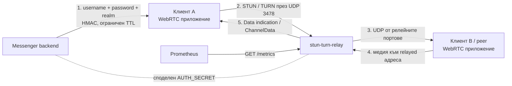
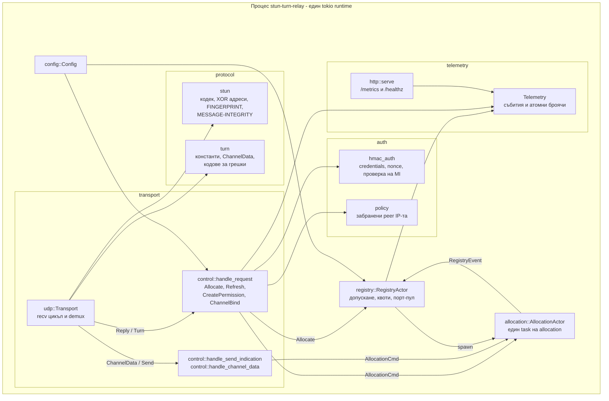
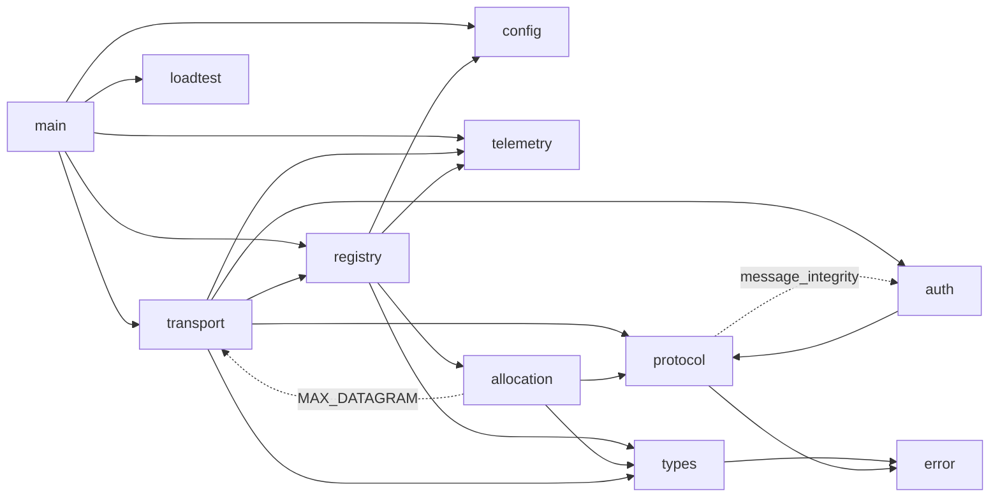
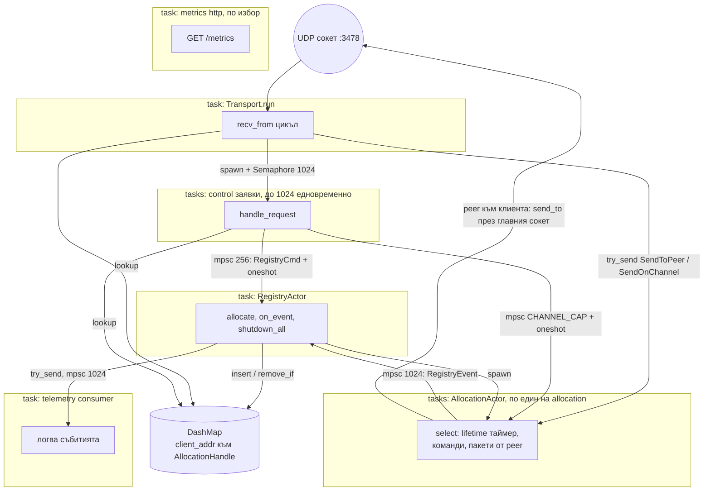
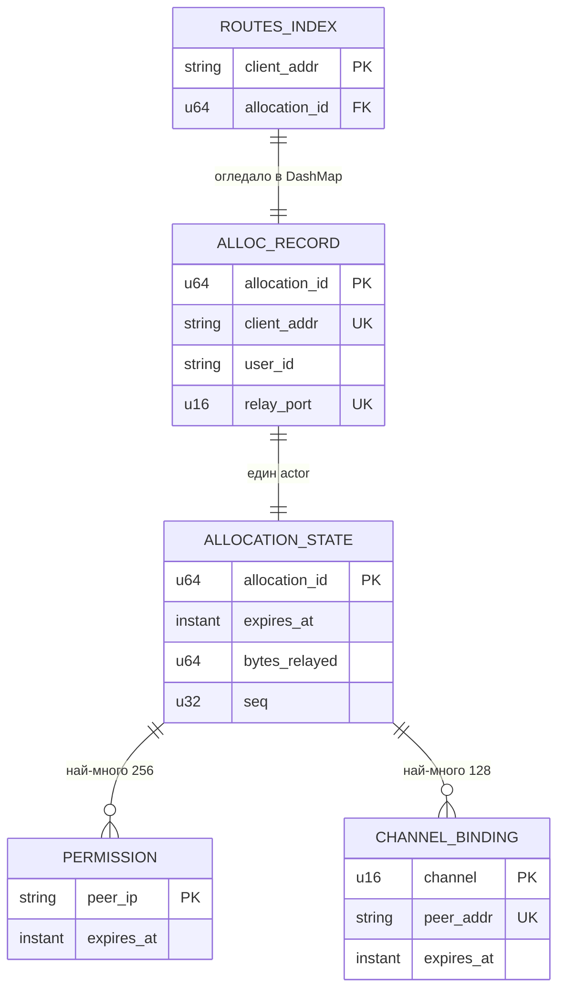
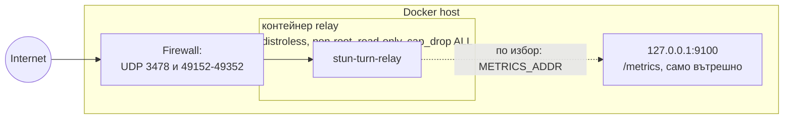

# 1. Архитектура

## 1.1 Цел и обхват

Релеят позволява на два клиента зад NAT да обменят медия, когато директна връзка (ICE) не е възможна. Поддържа:

- STUN Binding (откриване на публичния адрес);
- TURN Allocate, Refresh, CreatePermission, ChannelBind;
- Send/Data indication и ChannelData (релеиране на данни);
- time-limited HMAC credentials, IP политика срещу SSRF, лимити и метрики.

Извън обхвата: TURN-over-TCP, TLS/DTLS, външна база с потребители.

## 1.2 Системен контекст

Backend-ът и релеят **не си говорят** по мрежата. Те споделят само `AUTH_SECRET`; релеят проверява credentials без база данни.

## 1.3 Компоненти

Отговорности:

| Модул | Отговорност | Състояние |
|-------|-------------|-----------|
| `transport::udp` | Чете сокета, класифицира датаграмите, праща бързите пътища директно | Без споделено състояние |
| `transport::control` | Автентикира и изпълнява TURN заявки | Без състояние (`ControlCtx` е само за четене) |
| `registry` | Лимити, порт-пул, жизнен цикъл на allocation-и | Притежава се от един actor |
| `allocation` | Permissions, channels, lifetime, релеене | Притежава се от един actor на allocation |
| `auth` | Credentials, nonce, MESSAGE-INTEGRITY, IP политика | Чисти функции + secret |
| `telemetry` | Броячи и логове | Атомни стойности + bounded канал |

## 1.4 Зависимости между модулите

Пунктирните стрелки са две известни неточности в слоевете (рефакторинг за по-късно, без промяна на поведението):

1. `allocation` взема константата `MAX_DATAGRAM` от `transport::udp`;
2. `protocol::stun` вика `auth::hmac_auth::message_integrity` при кодиране с MESSAGE-INTEGRITY, а `auth` ползва `protocol` - има цикъл между двата модула. Криптографската функция може да се премести в отделен модул.

## 1.5 Модел на конкурентност

Идея: **без mutex-и по горещите пътища**. Състоянието има един собственик, а общуването е през bounded канали.

Правила:

- **Горещ път** (`ChannelData`, `Send`): един lookup в `DashMap`, един `try_send`, без копиране на payload-а (`Bytes::slice`). Ако опашката е пълна, пакетът се пуска (`dropped_packets`), а не се буферира.
- **Контролен път** (Allocate, Refresh, ...): отделен task на заявка, ограничен със `Semaphore(1024)`.
- **Peer към клиент**: `AllocationActor` праща директно през главния сокет, без междинен hop.
- **Shutdown**: `watch<bool>` спира `Transport`, после `RegistryCmd::ShutdownAll` затваря allocation-ите.

Размерите на опашките и останалите лимити са в `README.md` (конфигурация) и в [Замяна на coturn](06-coturn-migration.md#66-точка-5-политика-за-peer-адреси-и-лимити).

## 1.6 Данни в паметта

| Структура | Къде живее | Собственик |
|-----------|-----------|------------|
| `ROUTES_INDEX` | `Arc<DashMap>` в `RegistryHandle` | Пише `RegistryActor`, четат `Transport` и `control` |
| `ALLOC_RECORD`, `per_user`, `in_use_ports` | Полета на `RegistryActor` | `RegistryActor` |
| `ALLOCATION_STATE`, `PERMISSION`, `CHANNEL_BINDING` | Полета на `AllocationActor` | Съответният `AllocationActor` |

Инварианти:

- един allocation на клиентски адрес (иначе 437);
- един порт на allocation; портът се освобождава едва след `AllocationClosed`;
- един peer адрес е вързан най-много към един канал и обратно;
- `routes` се чисти с `remove_if`, само ако записът още сочи към същия allocation.

## 1.7 Deployment

- Публикуваният диапазон трябва да съвпада с `RELAY_MIN_PORT..RELAY_MAX_PORT`.
- `EXTERNAL_IP` е публичният адрес на хоста; той влиза във всеки `XOR-RELAYED-ADDRESS`.
- На Linux с висок трафик е по-добре `network_mode: host` (без Docker NAT за UDP).

## 1.8 Ключови архитектурни решения

| Решение | Причина | Компромис |
|---------|---------|-----------|
| Actor-и вместо споделено състояние с mutex | Няма lock contention, ясна собственост | Нужни са съобщения и опашки |
| `DashMap` за маршрутизация | Горещият път не минава през registry | Две места за истината (registry и map) - синхронизират се със събития |
| Stateless credentials и nonce | Няма база, лесно мащабиране | Няма отмяна преди `expiry` |
| `Bytes` zero-copy за Send/ChannelData | Малко копиране и алокации | Datagram-ът се копира веднъж при приемане |
| Bounded опашки + `try_send` | Предвидима памет, защита от претоварване | Пакети се губят при пренатоварване (приемливо за real-time медия) |
| Директно изпращане от allocation actor | По-малко hop-ове | Actor-ът знае за главния сокет |
| Без външни HTTP/крипто фреймуърци освен RustCrypto | Малка повърхност | Собствен минимален HTTP за метриките |
