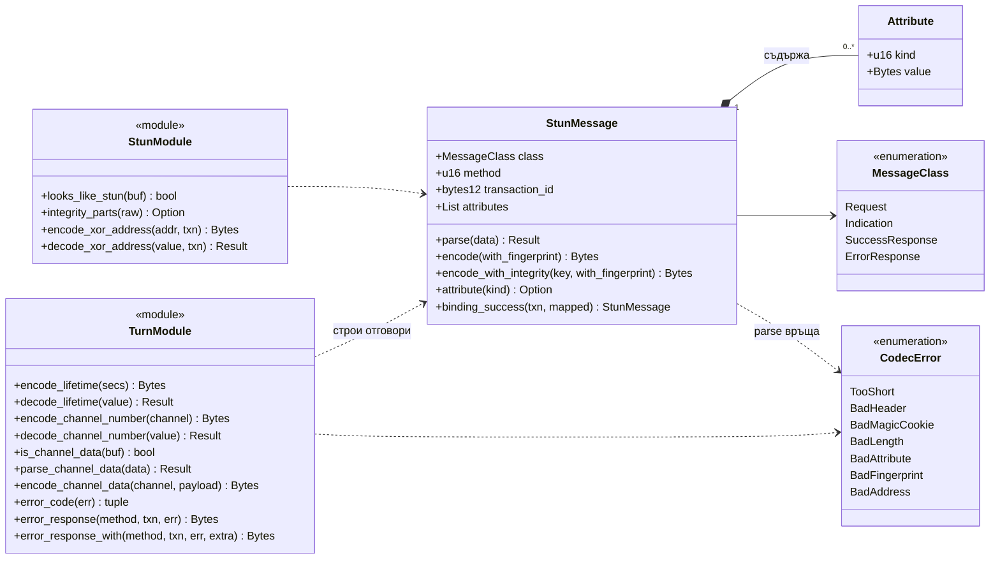
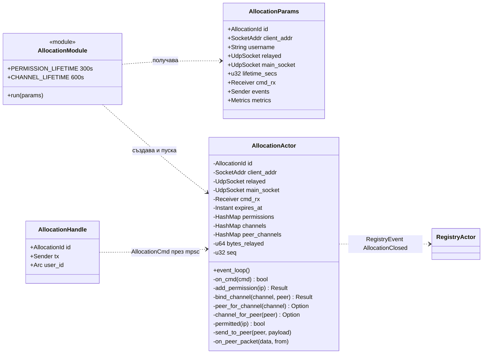
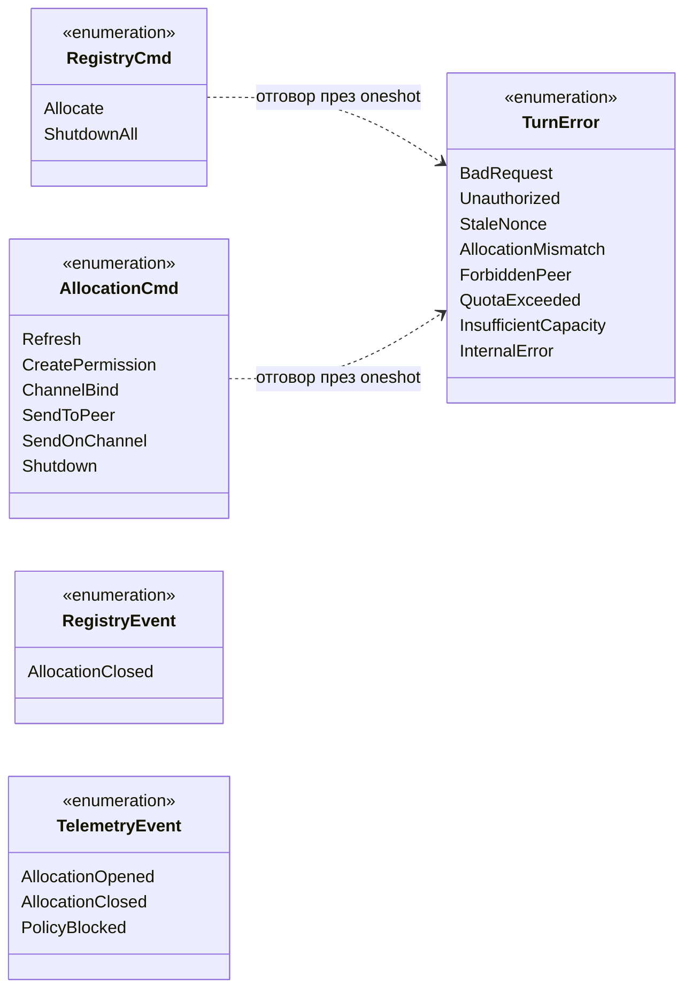
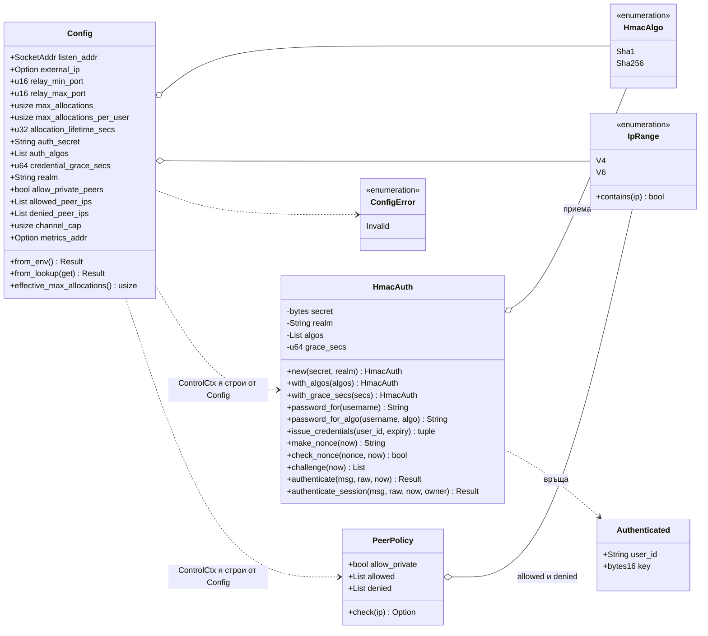
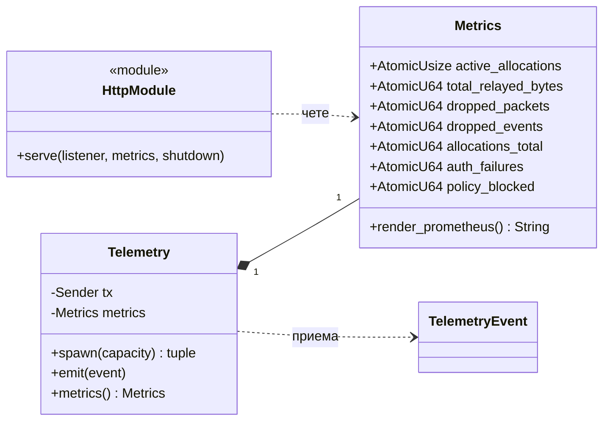
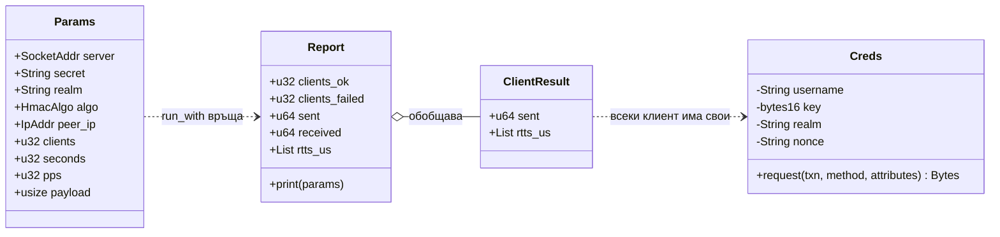
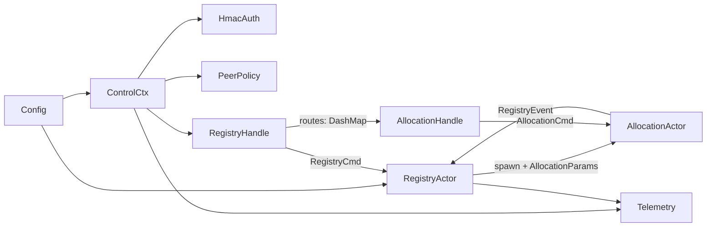

# 2. Клас диаграми

Диаграмите показват структурата на кода. За четимост типовете са опростени (без lifetimes и generic параметри); точните сигнатури са в сорс кода. Името на модула е в заглавието на всяка секция.

Условности: `+` публично, `-` частно, `<<enumeration>>` е Rust `enum`, `<<module>>` е група свободни функции.

## 2.1 Протоколен слой (`protocol::stun`, `protocol::turn`)

| Тип | Бележка |
|-----|---------|
| `MessageClass` | В кода се казва `Class` |
| `bytes12` | `[u8; 12]`, идентификатор на транзакцията |
| `Attribute.value` | `Bytes`: при `parse` е срез на входния datagram (без копиране) |
| `encode_with_integrity` | Добавя MESSAGE-INTEGRITY (HMAC-SHA1) преди незадължителния FINGERPRINT |

## 2.2 Транспорт, контрол и registry (`transport`, `registry`)

```mermaid
classDiagram
    direction LR
    class Transport {
        -ControlCtx ctx
        -UdpSocket socket
        -RegistryHandle registry
        -Metrics metrics
        -Semaphore control_slots
        +new(ctx) Transport
        +run(shutdown) Result
    }
    class Outcome {
        <<enumeration>>
        Reply
        Turn
        ChannelData
        Drop
    }
    class ControlCtx {
        +UdpSocket socket
        +RegistryHandle registry
        +Telemetry telemetry
        +HmacAuth auth
        +u32 default_lifetime_secs
        +PeerPolicy peer_policy
        +new(cfg, socket, registry, telemetry) ControlCtx
        -check_peer(client_addr, ip) Result
    }
    class ControlModule {
        <<module>>
        +handle_request(ctx, msg, raw, src)
        +handle_send_indication(registry, metrics, msg, src)
        +handle_channel_data(registry, metrics, channel, payload, src)
    }
    class RegistryHandle {
        -Sender tx
        -DashMap routes
        +lookup(client_addr) Option
        +allocate(client_addr, user_id, lifetime) Result
        +shutdown_all()
    }
    class RegistryActor {
        -RegistryConfig cfg
        -Receiver cmd_rx
        -Receiver event_rx
        -DashMap routes
        -HashMap allocs
        -HashMap per_user
        -HashSet in_use_ports
        -u16 next_port
        -u64 next_id
        +run()
        -allocate(client_addr, username, requested) Result
        -bind_relay_socket() Option
        -on_event(event)
        -shutdown_all()
    }
    class AllocRecord {
        +SocketAddr client_addr
        +String username
        +u16 port
        +AllocationHandle handle
    }
    class AllocationHandle {
        +AllocationId id
        +Sender tx
        +Arc user_id
    }
    class AllocationInfo {
        +AllocationId id
        +SocketAddr relayed_addr
        +u32 lifetime_secs
    }
    Transport o-- ControlCtx
    Transport ..> Outcome : handle_datagram
    Transport ..> ControlModule : spawn / вика
    ControlModule ..> ControlCtx
    ControlCtx --> RegistryHandle
    ControlCtx --> HmacAuth
    ControlCtx --> PeerPolicy
    ControlCtx --> Telemetry
    RegistryHandle ..> RegistryActor : RegistryCmd през mpsc
    RegistryHandle o-- AllocationHandle : routes
    RegistryActor "1" *-- "0..*" AllocRecord
    AllocRecord --> AllocationHandle
    RegistryActor ..> AllocationInfo : връща
```

| Поле | Значение |
|------|----------|
| `routes` | Общ `Arc<DashMap>` от клиентски адрес към `AllocationHandle`; пише го `RegistryActor`, четат го `Transport` и `control` |
| `allocs` | `HashMap` от `AllocationId` към `AllocRecord` (собственост на registry) |
| `per_user` | `HashMap` от `user_id` към брой активни allocation-и (квота) |
| `in_use_ports` | `HashSet` от заети релейни портове |
| `AllocationHandle.user_id` | Собственикът на allocation-а; ползва се за проверка на `Refresh`/`CreatePermission`/`ChannelBind` |

## 2.3 Allocation actor (`allocation`)

| Поле на `AllocationActor` | Съдържание |
|---------------------------|------------|
| `permissions` | `IpAddr` към момент на изтичане (до 256 записа) |
| `channels` | номер на канал към (peer адрес, изтичане), до 128 записа |
| `peer_channels` | обратен индекс: peer адрес към номер на канал |
| `expires_at` | краен срок на allocation-а; `Refresh` го мести |
| `seq` | брояч за уникален transaction id на Data indication |

## 2.4 Съобщения между actor-ите (`types`)

| Съобщение | Полета | Отговор |
|-----------|--------|---------|
| `AllocationCmd::Refresh` | `lifetime_secs`, `reply` | `oneshot<u32>`: даденият lifetime; `0` затваря allocation-а |
| `AllocationCmd::CreatePermission` | `peer_ip`, `reply` | `oneshot<Result>` |
| `AllocationCmd::ChannelBind` | `channel`, `peer_addr`, `reply` | `oneshot<Result>` |
| `AllocationCmd::SendToPeer` | `peer_addr`, `payload` | няма (`try_send`, при пълна опашка пакетът се пуска) |
| `AllocationCmd::SendOnChannel` | `channel`, `payload` | няма |
| `RegistryCmd::Allocate` | `client_addr`, `username` (user_id), `requested_lifetime_secs`, `reply` | `oneshot<Result<AllocationInfo>>` |
| `RegistryCmd::ShutdownAll` | `reply` | `oneshot<()>` |
| `RegistryEvent::AllocationClosed` | `allocation_id`, `client_addr`, `username`, `bytes_relayed` | няма |

## 2.5 Автентикация, политика, конфигурация и грешки (`auth`, `config`, `error`)

`TurnError` и `CodecError` са в [2.1](#21-протоколен-слой-protocolstun-protocolturn) и [2.4](#24-съобщения-между-actor-ите-types). `Config` има ръчна `Debug` реализация, която скрива `auth_secret`.

## 2.6 Telemetry (`telemetry`)

`Telemetry::emit` никога не блокира: при пълен канал събитието се пуска и `dropped_events` расте. Броячите са атомни (`Relaxed`) и се четат без заключване.

## 2.7 Инструмент за натоварване (`loadtest`)

## 2.8 Връзки между типовете (обобщено)

