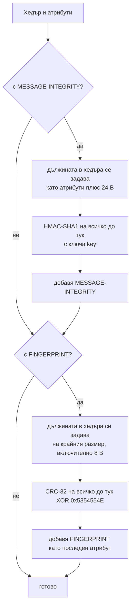
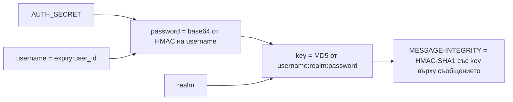
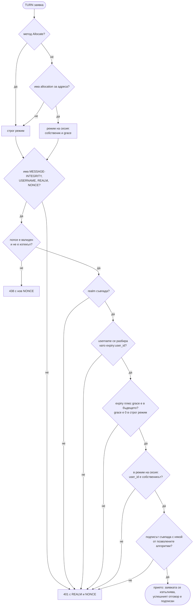
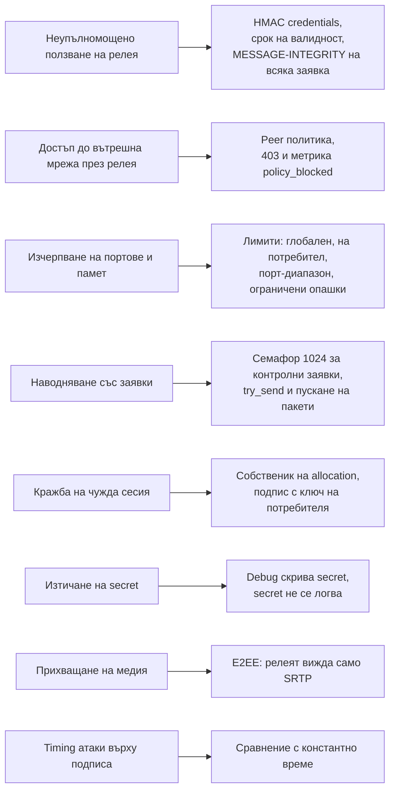

# 4. Протокол и сигурност

## 4.1 Поддържани протоколи

| Спецификация | Какво се поддържа |
|--------------|-------------------|
| STUN (RFC 5389 / 8489) | Binding Request, XOR-MAPPED-ADDRESS, FINGERPRINT, MESSAGE-INTEGRITY |
| TURN (RFC 5766 / 8656) над UDP | Allocate, Refresh, CreatePermission, ChannelBind, Send и Data indication, ChannelData |
| Автентикация | Long-term credentials с времево ограничени (REST API) username и парола, съвместими с coturn `use-auth-secret` |

Не се поддържат: TURN-over-TCP/TLS/DTLS, TURN TCP allocations към peer (RFC 6062), IPv6 allocation на IPv4 сокет и обратно, RESERVATION-TOKEN и EVEN-PORT.

## 4.2 Формати на пакетите

### STUN съобщение

| Байтове | Поле | Бележка |
|---------|------|---------|
| 0-1 | Тип на съобщението | Първите 2 бита са `00`; съдържа метод и клас |
| 2-3 | Дължина | Без 20-байтовия хедър, кратна на 4 |
| 4-7 | Magic cookie | `0x2112A442` |
| 8-19 | Transaction ID | 96 бита |
| 20... | Атрибути | TLV: тип (2 B), дължина (2 B), стойност, допълване до 4 B |

Тип на съобщението: `type = (method & 0xF) | ((method & 0x70) << 1) | ((method & 0xF80) << 2) | ((class & 1) << 4) | ((class & 2) << 7)`, където класът е 0 заявка, 1 индикация, 2 успех, 3 грешка.

| Съобщение | Метод | Тип |
|-----------|-------|-----|
| Binding Request / Success | `0x001` | `0x0001` / `0x0101` |
| Allocate Request / Success / Error | `0x003` | `0x0003` / `0x0103` / `0x0113` |
| Refresh Request | `0x004` | `0x0004` |
| Send indication | `0x006` | `0x0016` |
| Data indication | `0x007` | `0x0017` |
| CreatePermission Request | `0x008` | `0x0008` |
| ChannelBind Request | `0x009` | `0x0009` |

### ChannelData

| Байтове | Поле | Бележка |
|---------|------|---------|
| 0-1 | Номер на канал | `0x4000` до `0x7FFF`; първите 2 бита са `01` |
| 2-3 | Дължина на данните | |
| 4... | Данни | Над UDP допълването след края се игнорира |

Разграничаване от STUN по първия байт: `0x00-0x3F` е STUN, `0x40-0x7F` е ChannelData.

### Атрибути

| Атрибут | Код | Употреба |
|---------|-----|----------|
| USERNAME | `0x0006` | `expiry:user_id` |
| MESSAGE-INTEGRITY | `0x0008` | HMAC-SHA1, 20 B |
| ERROR-CODE | `0x0009` | Клас, номер, причина |
| CHANNEL-NUMBER | `0x000C` | Канал (2 B) и 2 B резервирани |
| LIFETIME | `0x000D` | Секунди (4 B) |
| XOR-PEER-ADDRESS | `0x0012` | Адрес на peer |
| DATA | `0x0013` | Payload на Send и Data indication |
| REALM | `0x0014` | От сървъра при 401 и 438; от клиента в заявки |
| NONCE | `0x0015` | Същото |
| XOR-RELAYED-ADDRESS | `0x0016` | `EXTERNAL_IP:релеен порт` |
| REQUESTED-TRANSPORT | `0x0019` | Първи байт 17 (UDP) |
| XOR-MAPPED-ADDRESS | `0x0020` | Адрес на клиента, видян от сървъра |
| FINGERPRINT | `0x8028` | CRC-32 XOR `0x5354554E`, винаги последен |

XOR адрес: портът се XOR-ва с горните 16 бита на magic cookie; IPv4 адресът с magic cookie; IPv6 адресът с magic cookie и transaction ID.

### Подпис и контролна сума



При проверка на MESSAGE-INTEGRITY дължината в хедъра се пренаписва така, че да завършва веднага след атрибута, затова приключващият FINGERPRINT не влияе на подписа.

## 4.3 Credentials и автентикация

### Схема

```
username = "<expiry_unix>:<user_id>"        (приема се и само "<expiry_unix>")
password = base64(HMAC-<algo>(AUTH_SECRET, username))      algo = SHA-1 или SHA-256
key      = MD5(username ":" realm ":" password)
MESSAGE-INTEGRITY = HMAC-SHA1(key, съобщението)
```



- `AUTH_HMAC_ALGO` избира алгоритъма за паролата (`sha1`, `sha256` или и двата). Подробности за миграцията: [06](06-coturn-migration.md#62-точка-1-credentials-hmac-sha1).
- **Nonce:** `<unix_време_в_hex>.<първите 8 B от HMAC-SHA256(secret, "nonce:<време>")>`, валиден 10 минути (с до 60 s допустимо изпреварване на часовника). Без състояние на сървъра.
- `user_id` е идентичността за квотите и за собствеността на allocation.

### Алгоритъм на проверката



Грешките 401 и 438 включват нов REALM и NONCE, така че клиентът може веднага да повтори. Сравнението на подписа е с константно време.

## 4.4 Код на грешка и къде се връща

| Код | `TurnError` | Кога |
|-----|-------------|------|
| 400 | `BadRequest` | Лош атрибут, не-UDP транспорт, лош канал, конфликт на канали, неподдържан метод |
| 401 | `Unauthorized` | Липсват или са невалидни credentials, изтекли credentials, чужд собственик |
| 403 | `ForbiddenPeer` | Peer адресът е забранен от политиката |
| 437 | `AllocationMismatch` | Няма allocation за този адрес (Refresh, CreatePermission, ChannelBind) или вече има (Allocate) |
| 438 | `StaleNonce` | Невалиден или изтекъл nonce |
| 486 | `QuotaExceeded` | Квота на потребителя, 256 permission-а или 128 канала |
| 500 | `InternalError` | Вътрешен канал към registry е затворен |
| 508 | `InsufficientCapacity` | Глобален лимит или изчерпан порт-диапазон |

Грешките се връщат с FINGERPRINT; само 401 и 438 носят REALM и NONCE. Успешните отговори на автентикирани заявки носят MESSAGE-INTEGRITY.

## 4.5 Peer политика (SSRF защита)

Редът на проверка и синтаксисът на `ALLOWED_PEER_IPS` / `DENIED_PEER_IPS` са в [06, 6.6](06-coturn-migration.md#66-точка-5-политика-за-peer-адреси-и-лимити). Вградено се блокират: loopback, private (RFC 1918), link-local (включително `169.254.169.254`), unspecified, multicast, broadcast, IPv6 ULA и link-local, както и IPv4-mapped IPv6 адреси на горните.

Peer адресът се проверява при `CreatePermission` и `ChannelBind`. Permission (и канал) се създават само за позволен адрес, затова `Send` и `ChannelData` не могат да достигнат забранен адрес.

## 4.6 Модел на заплахите



| Заплаха | Мерки | Остатъчен риск |
|---------|-------|----------------|
| Неупълномощено ползване | Подписани credentials със срок; всяка заявка е с MESSAGE-INTEGRITY; nonce | Откраднати валидни credentials работят до изтичане |
| Replay на заявка | Nonce (10 min) и срок на credentials | Няма кеш срещу повторение в рамките на nonce прозореца; въздействие ниско (Allocate повторен дава 437) |
| SSRF към вътрешни адреси | Вградени правила и конфигурируеми диапазони | Грешно зададен `ALLOWED_PEER_IPS` отваря достъп |
| Изчерпване на ресурси | Лимити от таблица 4.7 | Много устройства под един `user_id` споделят квотата |
| Amplification / reflection | Binding отговорът е малък | Автентикационният отговор 401 е по-голям от заявката; при подправен source IP е нужно ограничаване на скоростта на мрежово ниво |
| Подправен source на авторизиран клиент | Заявките върху allocation трябва да са подписани от собственика | Данните (ChannelData, Send) са без подпис по протокол и разчитат на 5-tuple |
| Изтичане на secret | Ротация на `AUTH_SECRET` (нужна синхронизация с backend-а) | Няма автоматична ротация; със старта на сървъра allocation-ите се губят |
| Часовник | Сървърът ползва системното време за срок и nonce | Разминаване на часовниците води до 401 или 438; нужен е NTP |

## 4.7 Лимити и времена

| Параметър | Стойност | Къде |
|-----------|----------|------|
| Максимален UDP datagram | 2048 B | `MAX_DATAGRAM` |
| Едновременни контролни заявки | 1024 | `Semaphore` в `Transport` |
| Опашка към registry | 256 | `mpsc` |
| Опашка за събития към registry | 1024 | `mpsc` |
| Опашка на allocation | `CHANNEL_CAP` (512) | `mpsc` |
| Опашка на telemetry | 1024 | `mpsc` |
| Връзки към metrics endpoint | 64 | `Semaphore` |
| Allocation-и глобално | `MAX_ALLOCATIONS` (2000), но не повече от портовете | registry |
| Allocation-и на потребител | `MAX_ALLOCATIONS_PER_USER` (16) | registry |
| Permission-и на allocation | 256 | actor |
| Канали на allocation | 128 | actor |
| Lifetime на allocation | подразбиране `ALLOCATION_LIFETIME_SECS` (300), максимум 600 | registry, actor |
| Lifetime на permission | 300 s | actor |
| Lifetime на channel binding | 600 s | actor |
| Валидност на nonce | 600 s (плюс 60 s допустимо изпреварване) | auth |
| Grace за изтекли credentials | `CREDENTIAL_GRACE_SECS` (3600), максимум 86400 | auth |
| Чакане при спиране | до 1 s на allocation, до 3 s общо; metrics 1 s; telemetry 2 s | main, registry |

## 4.8 Известни ограничения (протокол и сигурност)

- Само UDP. Няма TCP, TLS и DTLS.
- Няма кеш на отговорите: повторно изпратен (retransmit) `Allocate` след успех получава `437`, а повторен `Refresh` с 0 след изтриване получава `437`; клиентите по RFC третират втория като успех.
- Грешките, различни от 401 и 438, нямат MESSAGE-INTEGRITY.
- Семейството адреси на релейния сокет следва `LISTEN_ADDR`; peer от другото семейство е недостъпен.
- Няма ограничение на скоростта на неавтентикирани заявки и на трафика на allocation (bandwidth quota).
- Състоянието е в паметта на един процес: при рестарт всички allocation-и се губят и клиентите трябва да създадат нови.
- Собствеността се определя по `user_id`: всички устройства със същия `user_id` споделят квотата, но всяко управлява само allocation-а на собствения си 5-tuple (адрес на клиента).
