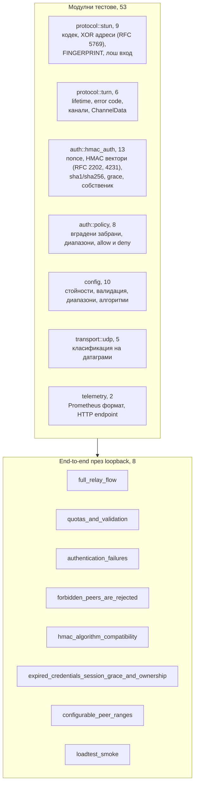

# 5. Експлоатация и тестове

## 5.1 Конфигурация

Всичко се задава с променливи на средата. Невалидна конфигурация спира процеса с изход код 2 и ясно съобщение в лога.

| Променлива | По подразбиране | Описание |
|-----------|-----------------|----------|
| `AUTH_SECRET` | **задължителна**, поне 16 символа | Споделен secret с backend-а |
| `AUTH_HMAC_ALGO` | `sha256` | `sha1` (coturn), `sha256` или `sha1,sha256` |
| `CREDENTIAL_GRACE_SECS` | `3600` | Колко след изтичане credentials важат за съществуващ allocation (0 до 86400) |
| `REALM` | `relay` | TURN realm |
| `LISTEN_ADDR` | `0.0.0.0:3478` | Входен UDP сокет |
| `EXTERNAL_IP` | IP от `LISTEN_ADDR` | Адрес, достижим от peer-ите, влиза във всеки XOR-RELAYED-ADDRESS |
| `RELAY_MIN_PORT`, `RELAY_MAX_PORT` | `49152`, `49352` | Релеен порт-диапазон (един порт на allocation); минимум 1024 |
| `MAX_ALLOCATIONS` | `2000` | Глобален лимит (реално най-много размера на порт-диапазона) |
| `MAX_ALLOCATIONS_PER_USER` | `16` | На `user_id` |
| `ALLOCATION_LIFETIME_SECS` | `300` | Подразбиращ се lifetime, от 1 до 600 |
| `CHANNEL_CAP` | `512` | Опашка на allocation |
| `ALLOWED_PEER_IPS` | празно | Изключения от забраните (IP, CIDR или `a-b`, през запетая) |
| `DENIED_PEER_IPS` | празно | Допълнителни забранени диапазони |
| `ALLOW_PRIVATE_PEERS` | `false` | **Само за разработка**: изключва вградените забрани |
| `METRICS_ADDR` | не е зададен | Напр. `127.0.0.1:9100`; включва `/metrics` и `/healthz` |
| `RUST_LOG` | `info` | Ниво на логовете, напр. `stun_turn_relay=debug` |

В `compose.yaml` допълнително има `TURN_PORT` (порт на слушане и на публикуване).

## 5.2 Команди

| Команда | Предназначение |
|---------|----------------|
| `stun-turn-relay` | Стартира сървъра |
| `stun-turn-relay mint-credentials <user_id> [ttl_secs]` | Печата `username`, `password`, `realm`, `expires_unix` (по подразбиране 3600 s) |
| `stun-turn-relay loadtest <server> [clients] [seconds] [pps] [payload]` | Симулира клиенти и показва RTT, jitter и загуби |

В Docker: `docker compose run --rm relay mint-credentials alice 3600`.

## 5.3 Стартиране и спиране

Стартова последователност: конфигурация (изход 2 при грешка), връзване на UDP сокета (изход 1 при грешка), по избор връзване на metrics порта, пускане на telemetry, registry и транспорта. При старт се записва конфигурацията без secret и предупреждения за:

- липсващ `EXTERNAL_IP` при неспецифициран `LISTEN_ADDR`;
- порт-диапазон по-малък от `MAX_ALLOCATIONS` (реалният капацитет е размерът на диапазона);
- `ALLOW_PRIVATE_PEERS=true`.

Спиране (`SIGTERM`, Ctrl-C): [диаграма 3.9](03-behavior.md#39-плавно-спиране). Compose дава 10 s `stop_grace_period`.

## 5.4 Метрики и логове

| Метрика | Тип | Значение |
|---------|-----|----------|
| `relay_active_allocations` | gauge | Текущо активни allocation-и |
| `relay_allocations_total` | counter | Създадени allocation-и |
| `relay_relayed_bytes_total` | counter | Релеирани байтове (двете посоки) |
| `relay_dropped_packets_total` | counter | Пуснати пакети: без permission, пълна опашка, грешка при изпращане, твърде голям |
| `relay_dropped_events_total` | counter | Пуснати telemetry събития |
| `relay_auth_failures_total` | counter | Заявки с 401 или 438 |
| `relay_policy_blocked_total` | counter | Peer адреси, отказани от политиката (403) |

Логове: `info` записва откриване и затваряне на allocation-и (`allocation opened` / `allocation closed` с байтове), `warn` е за политика и грешки при I/O, `debug` показва отхвърлени заявки и причините им.

Предложени сигнали за наблюдение:

| Сигнал | Какво означава |
|--------|----------------|
| `relay_active_allocations` близо до размера на порт-диапазона | Наближава се лимитът; очаквайте 508 |
| Нарастващ `relay_auth_failures_total` | Грешен secret или алгоритъм, разминат часовник, или опити за достъп |
| Нарастващ `relay_dropped_packets_total` | Пълни опашки, пакети без permission или твърде големи |
| `relay_policy_blocked_total` | Клиенти се опитват да достигнат забранени адреси |

## 5.5 Внедряване

Диаграма: [1.7](01-architecture.md#17-deployment). Стъпки:

1. Копирайте `.env.example` в `.env` и задайте `EXTERNAL_IP`, `AUTH_SECRET`, `REALM` (и при замяна на coturn: `AUTH_HMAC_ALGO=sha1`, портовете).
2. `docker compose up --build -d`.
3. Отворете във firewall-а UDP `TURN_PORT` и целия релеен диапазон.
4. Проверете с `mint-credentials` и външен TURN клиент (виж [6.7](06-coturn-migration.md#67-план-за-проверка-преди-замяна)).
5. По избор: `METRICS_ADDR=0.0.0.0:9100` в контейнера и `127.0.0.1:9100:9100` в `ports`.

Контейнерът е без shell, работи като непривилегирован потребител, файловата система е само за четене, всички capabilities са свалени.

## 5.6 Капацитет

| Ограничение | Формула | Пример |
|-------------|---------|--------|
| Едновременни allocation-и | `min(MAX_ALLOCATIONS, порт-диапазон)` | 49160-49200 = 41 |
| Едновременни релейни разговори | allocation-и / участници на разговор | 41 / 2, около 20 |
| Честотна лента | около 2 x битрейт на поток (вход и изход) за всеки релеиран участник | 1 Mbit/s във всяка посока на разговор означава около 2 Mbit/s вход и около 2 Mbit/s изход |

Паметта и процесорът зависят от натоварването; използвайте `loadtest` и `docker stats`, вместо да разчитате на оценка. Всеки allocation има един UDP сокет и един tokio task с 2 KB буфер плюс опашка.

Примерен тест (в рамките на реалния порт-диапазон, от друга машина):

```bash
AUTH_SECRET=... REALM=telex AUTH_HMAC_ALGO=sha1 \
LOADTEST_PEER_IP=<адрес, достижим от релея> \
stun-turn-relay loadtest <host>:3478 40 60 50 160
```

Сървърът трябва да допуска peer адреса (`ALLOW_PRIVATE_PEERS=true` или `ALLOWED_PEER_IPS` за тестови мрежи).

## 5.7 Отстраняване на проблеми

| Симптом | Вероятна причина | Какво да направите |
|---------|------------------|--------------------|
| 401 в цикъл | Различен `AUTH_SECRET`, `REALM` или алгоритъм; изтекъл `expiry`; разминат часовник | Сравнете с `mint-credentials`; проверете NTP; `RUST_LOG=debug` показва `authentication failed` |
| 438 в цикъл | Nonce се отхвърля: разминат часовник | Проверете NTP на сървъра и клиента |
| 437 при Refresh | Allocation-ът е изтекъл или адресът на клиента се е сменил (NAT rebind) | Клиентът трябва да направи нов Allocate |
| 486 | Квота на потребителя (`MAX_ALLOCATIONS_PER_USER`) | Старите allocation-и не са затворени; увеличете лимита или намалете lifetime |
| 508 | Глобален лимит или изчерпан порт-диапазон | Разширете `RELAY_MIN_PORT..RELAY_MAX_PORT` и публикуваните портове |
| 403 | Peer адресът е забранен | Проверете `relay_policy_blocked_total` и лога; добавете `ALLOWED_PEER_IPS` само за доверени адреси |
| Allocate е успешен, но няма медия | Грешен `EXTERNAL_IP`; затворен релеен диапазон; peer зад NAT, който не пуска; няма permission | Проверете relayed адреса от отговора, firewall, `CreatePermission` |
| `relay_dropped_packets_total` расте | Пакети без permission, пълна опашка, над 2048 B | `debug` логове; увеличете `CHANNEL_CAP`, ако опашките са пълни |
| Разговорът прекъсва след около час | Изтекли credentials извън grace | Увеличете TTL или `CREDENTIAL_GRACE_SECS`; приложението да подновява credentials |
| Процесът излиза с код 2 | Невалидна конфигурация | Прочетете съобщението в лога |
| Процесът излиза с код 1 | Портът е зает | Освободете порта или сменете `LISTEN_ADDR` / `METRICS_ADDR` |
| `/metrics` е недостъпен | Слуша на `127.0.0.1` вътре в контейнера | Задайте `METRICS_ADDR=0.0.0.0:9100` и публикувайте порта само към loopback |

## 5.8 Тестове

Общо **61 теста**: 53 модулни и 8 end-to-end. Пускат се с `cargo test`.



| End-to-end тест | Какво доказва |
|-----------------|---------------|
| `full_relay_flow` | Binding, 401 с challenge, Allocate с подписан отговор, 437 при повторение, permission, Send и Data indication, ChannelBind (и конфликти), ChannelData в двете посоки, Refresh (лимит 600, затваряне), повторен Allocate |
| `quotas_and_validation` | 486 на потребител, 508 глобално, 437 без allocation, 400 при не-UDP транспорт |
| `authentication_failures` | Фалшив secret, изтекли credentials, лош и остарял nonce |
| `forbidden_peers_are_rejected` | 403 за loopback, private и link-local; публични адреси минават |
| `hmac_algorithm_compatibility` | `sha1` приема SHA-1 и отказва SHA-256; режимът `sha1,sha256` приема и двата |
| `expired_credentials_session_grace_and_ownership` | Grace за съществуващ allocation, 401 за нов, чужд собственик, режим без grace (тестът чака около 3 s) |
| `configurable_peer_ranges` | `ALLOWED_PEER_IPS` бие вградените забрани; `DENIED_PEER_IPS` (диапазон и единичен адрес) |
| `loadtest_smoke` | 3 симулирани клиента, 150 изпратени пакета, ехо през релея |

Какво тестовете **не** покриват: съвместимост с реалния backend и WebRTC клиенти, реални NAT-ове, поведение под продължително натоварване, TCP. План: [6.7](06-coturn-migration.md#67-план-за-проверка-преди-замяна).

## 5.9 Възможни оптимизации (след измерване)

Не оптимизирайте преди данните от `loadtest` и `docker stats`. Кандидати, подредени по очакван ефект спрямо риск:

| Идея | Очакван ефект | Риск и цена |
|------|---------------|-------------|
| Няколко приемащи цикъла (`SO_REUSEPORT`) | По-висока пропускливост на многоядрени машини | Средна сложност; маршрутизацията е по адрес на клиента, така че пакетите на един клиент трябва да остават в един цикъл |
| Пакетно приемане и изпращане (`recvmmsg`, `sendmmsg`, UDP GSO) | По-малко системни извиквания | Платформено зависимо; средна сложност |
| Без копиране при приемане (вместо `copy_from_slice`) | По-малко алокации на пакет | Нужна е промяна на цикъла и жизнения цикъл на буферите |
| Директно кодиране на Data indication (без `StunMessage`) | По-малко копия на peer към клиент | Малка промяна, но повече ръчен код |
| Ограничаване на скоростта на неавтентикирани заявки | Защита от amplification | Нужна политика за лимитите |
| Кеш на отговорите за retransmit | Идемпотентен Allocate и Refresh | Памет за транзакциите; нужен срок |
| IPv6 релеене и двойно семейство | Покритие на IPv6 мрежи | Средна сложност |
| Bandwidth квота на allocation | Защита на честотната лента | Нужно е броене на байтове на интервал |
| Преместване на `message_integrity` в отделен крипто модул | По-чиста архитектура (няма цикъл protocol и auth) | Само рефакторинг |
| TURN-over-TCP/TLS | Покритие на ограничени мрежи | Голяма задача; виж [6.4](06-coturn-migration.md#64-точка-2-turn-over-tcp) |

## 5.10 Контролен списък преди продукция

| Проверка | Състояние |
|----------|-----------|
| `cargo test` минава | към вас |
| Паролата от `mint-credentials` съвпада с backend-а | към вас |
| Външен TURN клиент получава `relay` кандидат | към вас |
| Разговор през принудителен relay с реални клиенти | към вас |
| Дълъг разговор през изтичане на credentials | към вас |
| Натоварване (`loadtest`) с измерена памет | към вас |
| Порт-диапазонът е достатъчен за очаквания брой разговори | към вас |
| Firewall: UDP `TURN_PORT` и релейният диапазон | към вас |
| Метриките и логовете са свързани с наблюдение | към вас |
| `ALLOW_PRIVATE_PEERS` не е `true` | към вас |
| NTP на сървъра | към вас |
| Решение за TCP | към вас |
