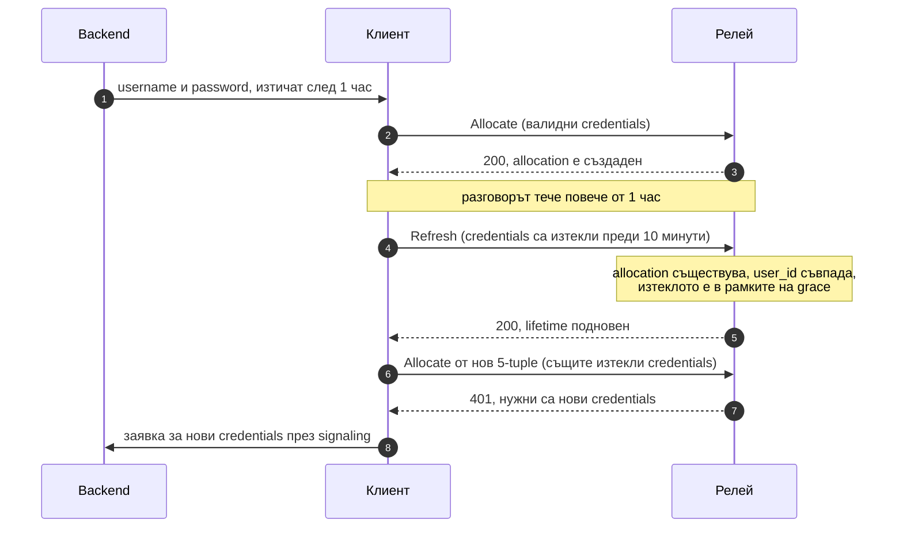
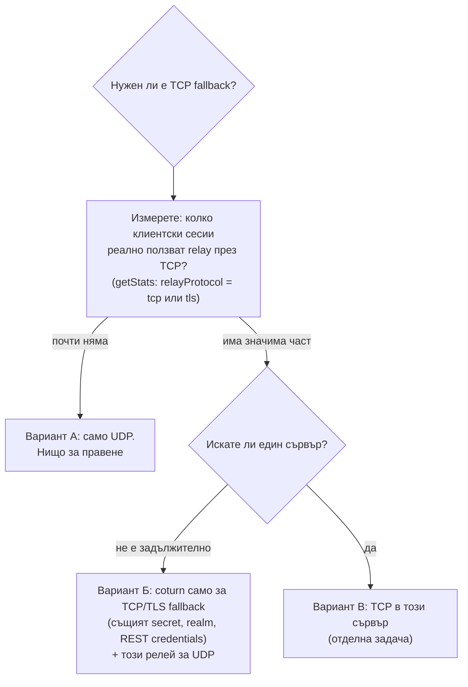
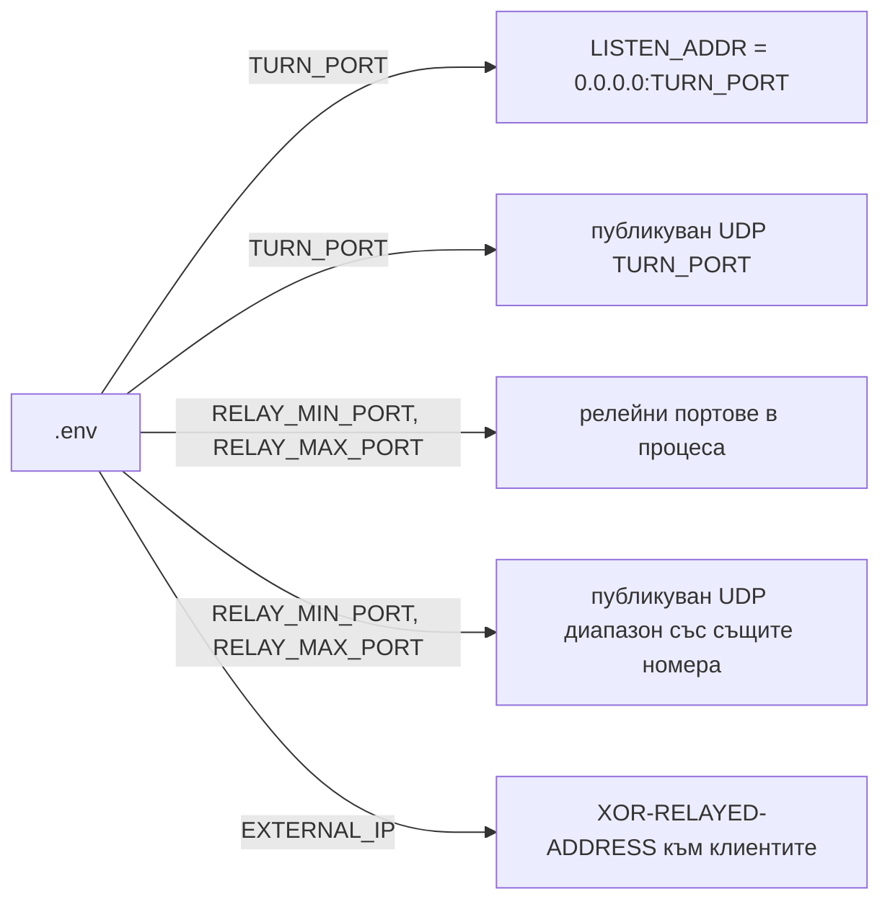
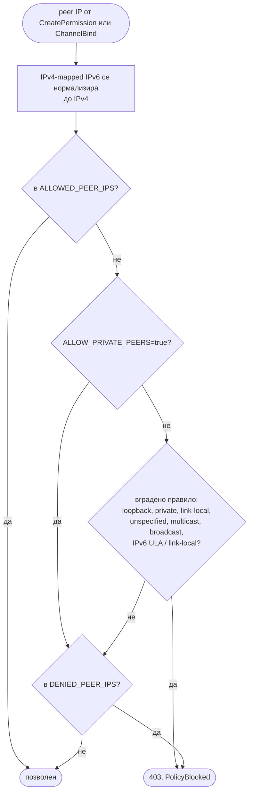
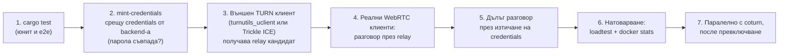

# 6. Замяна на coturn: разлики и решения

Сравнението е по предоставената Docker конфигурация на текущия coturn. Реалният backend и клиентите още не са проверени, затова всяка точка има статус и какво трябва да се провери.

## 6.1 Обобщение

| # | Разлика | Статус | Решение |
|---|---------|--------|---------|
| 1 | Парола: coturn ползва HMAC-**SHA1**, сървърът ползваше SHA-256 | **Решено в кода** | `AUTH_HMAC_ALGO=sha1` (или `sha1,sha256` за плавна миграция). Приема се и `username` само с timestamp |
| 2 | Само UDP, няма TURN-over-TCP | **Нужно е решение** | Виж 6.4: най-евтиният вариант е coturn само за TCP/TLS fallback със същия secret |
| 3 | Credentials изтичат по време на дълъг разговор | **Решено в кода** | `CREDENTIAL_GRACE_SECS`: съществуващ allocation се подновява и с изтекли credentials, но само от собственика му |
| 4 | Docker: портове и диапазон не съвпадат с конфигурацията | **Решено в compose** | Публикуваните портове се извеждат от същите променливи (`TURN_PORT`, `RELAY_MIN_PORT`, `RELAY_MAX_PORT`) |
| 5 | Политика за peer адреси и лимити | **Решено** + проверка | `ALLOWED_PEER_IPS` / `DENIED_PEER_IPS` с coturn-подобен синтаксис; лимитите се сверяват с реалния трафик |

Важно: всичко по-горе е написано без компилатор и не е пускано. Локалните тестове няма да докажат съвместимост с реалния backend и WebRTC клиентите; вижте плана за проверка в 6.7.

## 6.2 Точка 1: credentials (HMAC-SHA1)

coturn с `use-auth-secret` изчислява: `usercombo = "<timestamp>:<username>"`, `password = base64(HMAC-SHA1(secret, usercombo))`. Същата схема е в сървъра, но алгоритъмът е конфигурируем:

| `AUTH_HMAC_ALGO` | Приема пароли от | Кога |
|------------------|------------------|------|
| `sha1` | HMAC-SHA1 (coturn) | Директна замяна на coturn без промяна в backend-а |
| `sha256` (по подразбиране) | HMAC-SHA256 | Нов backend |
| `sha1,sha256` | и двете | Миграция: backend-ът минава на SHA-256 без прекъсване |

Първият алгоритъм в списъка се ползва от `mint-credentials`. Нужно е още: **същият `AUTH_SECRET`** и **същият `REALM`** като в coturn (`static-auth-secret`, `realm`).

Формат на `username`: `"<expiry_unix>:<user_id>"`. Приема се и само `"<expiry_unix>"` (coturn позволява timestamp без id; тогава цялото име е идентичността за квотите). За да се провери реалният генератор на backend-а, сравнете с `mint-credentials`:

```bash
AUTH_SECRET=<същия secret> REALM=telex AUTH_HMAC_ALGO=sha1 \
  stun-turn-relay mint-credentials alice 3600
```

Ако backend-ът за същия `username` дава същата `password`, форматът е съвместим.

## 6.3 Точка 3: дълги разговори

Проблемът: сървърът проверява срока на credentials при всяка заявка, а клиентът подновява allocation-а на всеки ~5 минути (Refresh). Ако credentials изтекат по средата на разговор, Refresh би се отхвърлил и медията щеше да спре.

Решението има три правила:

1. `Allocate` е винаги строг: изтекли credentials не могат да създадат нов allocation.
2. `Refresh`, `CreatePermission` и `ChannelBind` върху **съществуващ** allocation приемат credentials, изтекли до `CREDENTIAL_GRACE_SECS` секунди назад (по подразбиране 3600).
3. Заявките върху съществуващ allocation трябва да идват от неговия собственик (същият `user_id`). Друг потребител получава 401, дори с валидни credentials.



Максимална продължителност на разговор без преиздаване на credentials = TTL на credentials + `CREDENTIAL_GRACE_SECS`. Препоръка: TTL над типичния разговор, а приложението да подновява credentials от backend-а преди изтичане, за да може и ICE restart (нов allocation) да работи. Конкретният срок е бизнес решение; изисква тест с реалните клиенти.

Забележка: поведението на coturn при изтекла парола в поддържана сесия е описано в документа за сравнение, но не съм го сверявал с неговия първоизточник. Тук е реализиран описаният резултат (сесията оцелява), а не алгоритъмът на coturn.

## 6.4 Точка 2: TURN-over-TCP

Текущият coturn публикува UDP и TCP на TURN порта; този сървър е само UDP. Клиент, който може да стигне до TURN само през TCP (строги корпоративни мрежи, някои мобилни оператори), няма да получи relay.



| Вариант | Усилие | Плюсове | Минуси |
|---------|--------|---------|--------|
| А. Само UDP | Няма | Най-просто | Част от мрежите остават без relay |
| Б. coturn за TCP/TLS + този релей за UDP | Малко (конфигурация) | Работи веднага, без нов код; credentials са общи | Две услуги за поддръжка |
| В. TCP в този сървър | Средно-голямо | Един сървър | Нов код: абстракция на клиентския транспорт (UDP сокет или TCP връзка), рамкиране на потока, backpressure за бавни връзки, идентичност на клиента без 5-tuple по адрес; нужни са нови тестове |

Вариант Б е възможен благодарение на точка 1: еднаква схема за credentials означава, че списъкът `iceServers` може да съдържа и двата сървъра с едни и същи `username`/`credential`. Вариант В не е започнат; решението е ваше.

## 6.5 Точка 4: Docker и мрежови настройки

Съответствие на настройките:

| coturn | Този сървър |
|--------|-------------|
| `realm` | `REALM` (напр. `telex`) |
| `static-auth-secret` | `AUTH_SECRET` |
| `use-auth-secret` | `AUTH_HMAC_ALGO=sha1` |
| `listening-port` | `TURN_PORT` (compose) или `LISTEN_ADDR` |
| `min-port` / `max-port` | `RELAY_MIN_PORT` / `RELAY_MAX_PORT` (напр. 49160 / 49200) |
| `external-ip` | `EXTERNAL_IP` |
| `allowed-peer-ip` / `denied-peer-ip` | `ALLOWED_PEER_IPS` / `DENIED_PEER_IPS` |
| `total-quota` / `user-quota` | `MAX_ALLOCATIONS` / `MAX_ALLOCATIONS_PER_USER` |
| `lt-cred-mech`, `fingerprint`, `stale-nonce` | Винаги включени (nonce е валиден 10 минути) |
| `no-loopback-peers`, `no-multicast-peers` | Вградени правила (не се изключват, освен с `ALLOW_PRIVATE_PEERS`) |

Сверете имената с реалния `turnserver.conf`; таблицата е по общата документация на coturn.

`compose.yaml` вече извежда публикуваните портове от същите променливи като конфигурацията, така че не могат да се разминат:



Капацитет: всеки allocation заема **един** релеен порт, затова при диапазон 49160-49200 (41 порта) максимумът е **41 едновременни allocation-а**, независимо от `MAX_ALLOCATIONS=2000`. Всеки участник в разговор обикновено създава собствен allocation (при събиране на ICE кандидати), т.е. около 20 едновременни 1:1 разговора. Ако текущият coturn е със същия диапазон, ограничението е същото; ако очаквате повече натоварване, разширете диапазона (и публикуваните портове). При старт сървърът предупреждава в лога, когато диапазонът е по-малък от `MAX_ALLOCATIONS`.

Зад NAT: `EXTERNAL_IP` трябва да е адресът, достижим от peer-ите, а релейните портове се препращат със **същите номера**. `network_mode: host` избягва Docker NAT за UDP при висок трафик.

## 6.6 Точка 5: политика за peer адреси и лимити

Редът на оценка на peer адрес:



- Синтаксис: списък през запетая от единичен IP, CIDR (`10.0.0.0/8`) или диапазон (`10.0.0.0-10.255.255.255`), IPv4 и IPv6.
- `ALLOWED_PEER_IPS` е изрично изключение (напр. вътрешен медиен сървър), което бие вградените правила. Не е еквивалент на всичко във `--denied-peer-ip` на coturn, но покрива същото намерение: допълнителни забрани (`DENIED_PEER_IPS`) и изключения.
- `ALLOW_PRIVATE_PEERS=true` е само за разработка; не изключва правилата от `DENIED_PEER_IPS`.
- Разликата спрямо coturn: IPv6 ULA (`fc00::/7`) и link-local (`fe80::/10`) се блокират вградено. В локални или IPv6 мрежи това може да промени поведението; изключения се добавят през `ALLOWED_PEER_IPS`.

Лимити: входящ UDP datagram до **2048 байта** (по-големите се пускат), **2000** allocation-а глобално и **16** на потребител по подразбиране (но реално ограничени от размера на порт-диапазона, виж 6.5), най-много 256 permission-а и 128 канала на allocation. Сверете ги с реалния трафик (максимален размер на пакетите, брой потребители, брой устройства на потребител, защото квотата е на `user_id`).

## 6.7 План за проверка преди замяна



| Стъпка | Как | Успех е, когато |
|--------|-----|-----------------|
| Credentials | `mint-credentials` с реален `username` от backend-а и сравнение на паролата | Паролите съвпадат |
| Външен клиент | Trickle ICE страницата на WebRTC samples с `turn:<host>:<порт>`, `username`, `credential`; или `turnutils_uclient` от пакета на coturn | Появява се кандидат от тип `relay` |
| Реални клиенти | Принудителен relay (`iceTransportPolicy: relay`) в тестов билд | Разговорът тече, `relayProtocol = udp` |
| Дълъг разговор | `mint-credentials` с TTL 120 s и разговор над 5 минути | Няма прекъсване при изтичането; нов Allocate с изтеклите credentials дава 401 |
| Натоварване | `stun-turn-relay loadtest <host:порт> 40 60 50 160` (в рамките на реалния порт-диапазон) | Загуби и RTT в приемливи граници, паметта е стабилна |
| TCP | Ако е нужен: измерване на `relayProtocol = tcp/tls` в реалния трафик | Решение за вариант А, Б или В |
