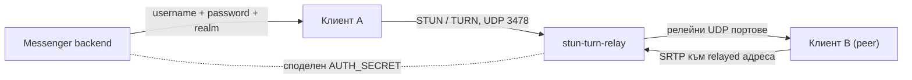

# Документация на stun-turn-relay

Лек STUN/TURN релей (UDP) за E2EE месинджър. Релеят пренася само непрозрачни (SRTP) пакети и никога не вижда ключове за медия.

| # | Документ | Какво съдържа |
|---|----------|---------------|
| 1 | [Архитектура](01-architecture.md) | Контекст, компоненти, зависимости между модули, модел на конкурентност, данни в паметта, deployment |
| 2 | [Клас диаграми](02-class-diagrams.md) | Структура на типовете: протокол, runtime, съобщения, auth/config/грешки, telemetry |
| 3 | [Поведение](03-behavior.md) | Sequence диаграми за всеки сценарий, state диаграми, flowchart-и на решенията |
| 4 | [Протокол и сигурност](04-protocol-security.md) | Формати на пакетите, атрибути, схема за credentials, модел на заплахите, лимити, кодове за грешки |
| 5 | [Експлоатация и тестове](05-operations-testing.md) | Конфигурация, метрики, внедряване, капацитет, troubleshooting, тестове, оптимизации |
| 6 | [Замяна на coturn](06-coturn-migration.md) | Разлики с coturn, решения, TCP варианти, план за проверка |

## Как да четеш

- Търсиш **какво е системата** -> 1.
- Искаш да **разбереш кода** -> 2, после 3.
- Правиш **интеграция с backend-а или ревю на сигурността** -> 4.
- **Пускаш в продукция** -> 5.
- **Заменяш coturn** -> 6.

## Обща картина

## Рендиране на диаграмите

Диаграмите са в Mermaid блокове. Рендират се директно в GitHub, GitLab, VS Code (Markdown Preview Mermaid Support), Obsidian и Mermaid Live Editor (mermaid.live). Ползвани са само стабилни типове: `flowchart`, `sequenceDiagram`, `classDiagram`, `stateDiagram-v2`, `erDiagram`. Всички диаграми са проверени с Mermaid CLI.

## Речник

| Термин | Значение |
|--------|----------|
| Allocation | Релеен ресурс на клиент: един UDP порт на сървъра (relayed address) |
| Relayed address | Адрес `EXTERNAL_IP:порт`, през който peer-ът праща към клиента |
| Peer | Отсрещната страна на разговора |
| Permission | Разрешение за IP на peer (300 s) |
| Channel | Кратък номер (0x4000-0x7FFF) за peer, за ChannelData без STUN хедър (600 s) |
| Nonce | Stateless токен от сървъра за long-term автентикацията (10 min) |
| 5-tuple | Тук: адресът на клиента (`SocketAddr`), по който се намира allocation-ът |
| Grace | Период след изтичане на credentials, в който съществуващ allocation още се подновява |
